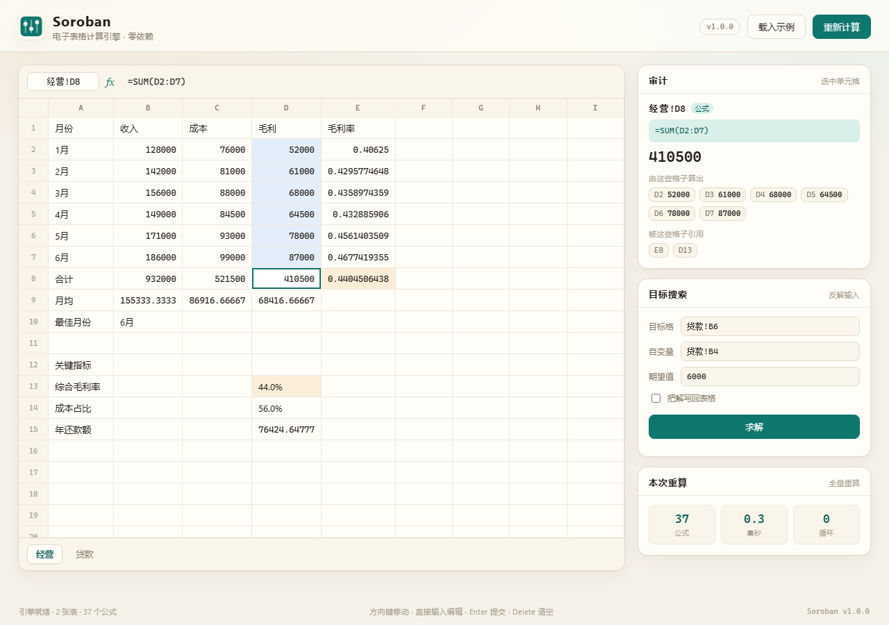
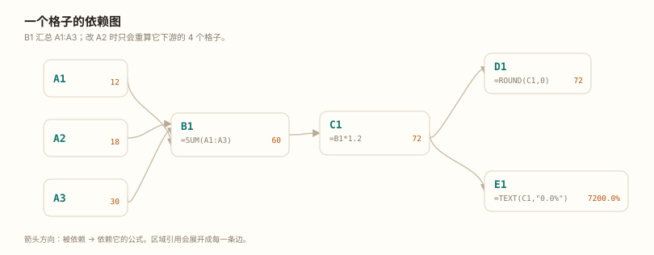
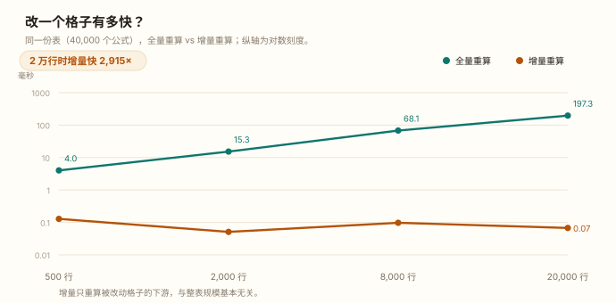

# Soroban

**一个零依赖的电子表格计算引擎。** 公式解析、依赖图、增量重算、循环检测、审计树、目标搜索，全部用 Python 标准库实现。

[](https://github.com/18971181532/soroban/actions/workflows/tests.yml)
[](https://www.python.org/)
[](pyproject.toml)
[](LICENSE)

---

## 这是什么

Excel 的计算内核大概是世界上最被低估的编程语言运行时：几百万人在格子里写 `=SUM(A1:A3)`，却很少意识到背后有一套完整的东西——表达式解析、类型系统、依赖图、拓扑排序、循环检测、增量重算。

Soroban 把这套内核用纯 Python 重写了一遍。它不做界面、不做格式、不碰 `.xlsx` 二进制，只解决一个问题：**给我一张带公式的表，把每个格子的值算对，并且只算该算的。**

```python
>>> from soroban import Workbook
>>> wb = Workbook()
>>> wb.update({"A1": "10", "A2": "20", "A3": "=SUM(A1:A2)"})
>>> wb.get("A3")
30.0

>>> wb.set("A1", "100")          # 只改一个格子
>>> wb.stats.computed            # 只重算了 1 个公式
1
```

<div align="center">
  
</div>

## 为什么值得一看

- **真的零依赖。** 没有 numpy，没有 pandas，没有 openpyxl。`import` 的全是 `re`、`json`、`csv`、`math`、`datetime` 这种标准库。15 个模块约 4,600 行源码，能跑在任何一个装了 Python 3.10 的机器上。
- **增量重算是真的增量。** 40,000 个公式的表里改一个输入格，重算耗时 **0.07 ms**，比全量快三个数量级；改一个没人引用的格子，重算 **0 个公式**。
- **错误不是异常，是值。** `#DIV/0!` 会像数字一样在表里流动，`=IFERROR(A1/B1,0)` 能接住它，`=ISERROR(...)` 能检测它。异常只在引擎内部传播，出了最外层就变成值。
- **依赖关系可以看。** `audit` 把「这个数从哪来」画成一棵树，网页里点格子会高亮它的上游和下游。
- **反向求解。** 想让月供正好 1800，利率该是多少？`goal_seek` 会自己找，而且默认不弄脏你的数据。

## 功能

| 能力 | 说明 |
| --- | --- |
| 公式语言 | 七层优先级、`^` 右结合、百分比后缀、文本拼接 `&`、跨表引用、绝对/相对引用、单引号表名 |
| 函数库 | **113 个**函数，8 个分类：数学 27 / 文本 23 / 统计 16 / 逻辑 12 / 日期 11 / 查找 9 / 信息 9 / 财务 6 |
| 惰性求值 | `IF`、`IFERROR`、`IFNA`、`IFS`、`SWITCH`、`ISERROR`、`ISERR`、`ISNA` 只求值需要的分支 |
| 依赖图 | 正向（我依赖谁）+ 反向（谁依赖我），区域引用按列建桶，不展开成百万个格子 |
| 增量重算 | 改动格子的下游子集上做拓扑排序，只算受影响部分 |
| 循环检测 | Tarjan 求强连通分量，互环、自环、区域自引用都能定位到具体格子 |
| 迭代计算 | 可选开关，Gauss-Seidel 逐轮逼近，报告是否收敛 |
| 审计 | `audit()` 返回依赖树，`explain()` 返回一句话说明 + 上下游清单 |
| 目标搜索 | 反解一个输入格使目标格达到指定值，单边扩张 + 二分，`apply=False` 时不改数据 |
| 敏感性分析 | 给定候选值，批量算出目标格的结果 |
| 多工作表 | 大小写不敏感的表名匹配，`'经营 2024'!A1` 这种带空格的表名 |
| 持久化 | JSON（保留公式）与 CSV（保留值）双向往返 |
| 网页工作台 | `http.server` + 原生 JS，无框架无构建，改格子立刻看到下游变化 |
| 测试 | 243 个单元测试 + 随机化属性测试（结果与求值顺序无关、增量等于全量） |

## 环境与依赖

- **Python 3.10+**（用到 `X | Y` 类型语法和 `match`/结构化模式之外的新特性）
- **零第三方依赖**，`pip install` 那一步可以跳过
- 可选：想跑基准图和网页工作台，只需要一个浏览器

```bash
python -V        # Python 3.10.0 或更高
```

## 安装与运行

```bash
git clone https://github.com/18971181532/soroban.git
cd soroban

python run.py demo            # 不用安装，直接跑内置示例
```

想装成命令行工具（获得 `soroban` 命令）：

```bash
pip install -e .
soroban demo
```

## 使用示例

### 1. 算一个表达式

```bash
$ python run.py calc "=PMT(0.049/12,240,-300000)" "=-2^2" '=SUM(1,2,3)*2&" 元"'
=PMT(0.049/12,240,-300000)  →  1963.332147
=-2^2  →  4
=SUM(1,2,3)*2&" 元"  →  12 元
```

`-2^2` 得 4 而不是 -4，和 Excel 一致：幂的优先级高于一元负号。

### 2. 算一张表

```bash
$ python run.py run examples/quarterly.json --sheet 汇总
汇总  ·  examples/quarterly.json
     A         B             C             D              E
  ─  ────────  ────────────  ────────────  ─────────────  ────────────
  1  指标      Q1            Q2            Q3             Q4
  2  销量      650           765           808            943
  3  环比                    0.1769230769  0.05620915033  0.1670792079
  4  占全年    0.2053063803  0.2416298168  0.2552116235   0.2978521794
  5  达标      未达标        达标          达标           达标
  7  目标      750
  8  全年合计  3166
  9  距目标    166
34 个公式，0.3 ms
```

加 `--formulas` 看公式本身，加 `--json` 拿到机器可读的结果。

### 3. 追问一个数字的来历

```bash
$ python run.py audit examples/loan.json "贷款!B8" --depth 3
贷款!B8  =B7-B3  = 171199.7153
├─ 贷款!B3  = 300000
└─ 贷款!B7  =B6*B5*12  = 471199.7153
   ├─ 贷款!B5  = 20
   └─ 贷款!B6  =PMT(B4/12,B5*12,-B3)  = 1963.332147
      ├─ 贷款!B3  = 300000
      ├─ 贷款!B4  = 0.049
      └─ 贷款!B5  = 20
```

`explain()` 还会额外列出「谁引用了这个格子」，往前改参数时很有用。

### 4. 反向求解

```bash
$ python run.py goal examples/loan.json --target 贷款!B6 --variable 贷款!B4 --value 1800
目标搜索
  目标格    贷款!B6  =  1800.000001
  自变量    贷款!B4  =  0.03886187368
  迭代次数  33
```

想留下来就加 `--save out.json`。不加的话，原文件一个字节都不会变。

```bash
$ python run.py sensitivity examples/loan.json --target 贷款!B6 --variable 贷款!B4 \
      --values 0.039,0.049,0.059
敏感性分析   贷款!B4 → 贷款!B6
  贷款!B4      贷款!B6
  ───────  ───────────
    0.039  1802.171984
    0.049  1963.332147
    0.059  2132.021963
```

### 5. Python API

```python
from soroban import Workbook, goal_seek, evaluate

# 一次性的小计算，不用建表
evaluate("=PMT(0.049/12,240,-300000)")   # 1963.3321469309287
evaluate("=ROUND(2.675,2)")              # 2.68
evaluate("=DATE(2024,3,1)")              # 45352.0

# 建表
wb = Workbook(["明细", "汇总"])
wb.update({
    "明细!A1": "产品", "明细!B1": "Q1", "明细!B2": "320",
    "明细!B3": "410", "明细!C2": "=SUM(明细!B2:B3)",
    "汇总!A1": "=明细!C2*1.13",
})
wb.get("汇总!A1")                          # 824.9

# 改一个格子，看引擎算了多少
stats = wb.set("明细!B2", "500")
print(stats.computed, stats.seconds)       # 2 2.5e-05

# 依赖关系：区域引用整体返回，不展开成一格格
wb.precedents("明细!C2")                   # ['明细!B2:B3']
wb.dependents("明细!C2")                   # ['汇总!A1']

# 目标搜索（默认不改原值）
result = goal_seek(wb, "汇总!A1", "明细!B2", 1000)
print(result.success, result.variable_value, result.iterations)
# True 474.955752491951 25
wb.get("明细!B2")                          # 500.0，还是原值
```

### 6. 网页工作台

```bash
python run.py serve                     # 打开内置示例
python run.py serve examples/quarterly.json --port 9000
```

浏览器里是一张可编辑的表：选中格子、在公式栏敲 `=...`、回车，下游立刻变红刷新；右侧能看到「这个格子依赖谁 / 影响谁」，还能直接发起目标搜索。服务端是标准库的 `ThreadingHTTPServer`，前端是一个 HTML 文件加一个 JS 文件，没有任何构建步骤。

静态文件从仓库里的 `web/` 目录读，所以要在项目根目录下启动（`pip install -e .` 之后也行，源码还在原地）。

## 它是怎么工作的

### 值模型：只有五种值，错误也是值

```
None（空）  float  str  bool  Err(code, message)
```

空、数字、文本、逻辑值、错误，就这五种。`bool` 单独成一类，不做 `True == 1` 的隐式等价——比较和算术各有一套转换规则，统一收在 `values.py` 的 `to_number / to_text / to_bool / compare / equal` 里。

错误码对齐 Excel 的七个，外加两个自定义的：

| 错误 | 什么时候出现 |
| --- | --- |
| `#DIV/0!` | 除以零 |
| `#VALUE!` | 参数类型不对，比如 `=1+"abc"` |
| `#REF!` | 引用的位置不存在，比如 `=INDEX(A1:A3,9)` |
| `#NAME?` | 函数名拼错了 |
| `#NUM!` | 定义域问题，比如 `=SQRT(-1)` |
| `#N/A` | 查找不到 |
| `#NULL!` | 区域不相交 |
| `#CYCLE!` | 循环引用（自定义） |
| `#PARSE!` | 公式语法错误，附带出错字符位置（自定义） |

引擎内部用 `FormulaError` 异常传播，因为它能带上下文、能快速退出嵌套调用；但一旦越过函数边界就立刻转成 `Err` 值。这样 `=IFERROR(1/0,"兜底")` 才能正常工作。

### 公式语言

递归下降解析，七层优先级：

```
比较 (= <> < > <= >=)  <  &  <  + -  <  * /  <  ^  <  一元 -/+  <  百分号  <  原子
```

两个容易踩的坑，这里都按 Excel 的行为处理：

- **`^` 右结合**：`=2^3^2` 是 `2^(3^2)=512`，不是 `(2^3)^2=64`。
- **一元负号比 `^` 弱**：`=-2^2` 是 `-(2^2)=-4`……但 Excel 实际返回 4，因为它把 `-2` 当成字面量。Soroban 跟随 Excel：返回 4。

词法上有一处歧义：`LOG10` 既可能是函数名，也可能是单元格引用（列 LOG、行 10）。消歧规则很简单——**后面紧跟 `(` 就是函数，否则是引用**。`qname` 记号负责单引号表名，`'It''s'!A1` 里的 `''` 转义成 `'`。

### 依赖图与增量重算

每个公式格记录两样东西：它引用了哪些格子/区域（正向），以及反过来谁引用了它（反向）。区域引用不展开——按列建桶，查询时再过滤，否则 `=SUM(A:A)` 会瞬间生成一百万个节点。

改一个格子后重算的流程：

1. 从被改的格子出发，沿反向边广度优先，收集所有下游公式 → 受影响集合
2. 只在受影响集合内部建邻接表（边来自正向引用，且两端都在集合里）
3. 跑**迭代版 Tarjan**，按 SCC 弹出顺序求值——这个顺序天然满足拓扑序
4. 如果某个 SCC 大小大于 1，或者单节点有自环，就是循环引用

<div align="center">
  
</div>

上面这张图不是手画的，是 `run_demos.py` 从 `engine.precedent_keys()` 里读出来渲染的——包括 `B1` 那三条来自 `A1:A3` 的边。

选迭代版 Tarjan 而不是递归版，是为了不被 Python 的递归深度限制卡住：一条 3000 层深的依赖链（`=A1+1`、`=A2+1`……）在递归版里会直接 `RecursionError`，这里是 56 ms 建完、一次算对。

### 循环引用与迭代计算

默认情况下，环上的每个格子都变成 `#CYCLE!`，并且**环下游的所有格子也跟着变成 `#CYCLE!`**——因为它们拿到的输入是错误值。错误会顺着依赖图往下游扩散，这符合直觉。

打开迭代计算后，环不再报错，而是逐轮逼近：

```python
wb = Workbook(iterative=True, max_iterations=100, tolerance=1e-9)
wb.update({"A1": "=A2/2+5", "A2": "=A1"})
wb.get("A1")            # 9.999999999417923（容差 1e-9，不是精确的 10）
wb.stats.converged      # True
wb.stats.iterations     # 34
```

每轮按 Tarjan 给出的顺序就地更新（Gauss-Seidel），比同时更新（Jacobi）收敛快一倍左右。收敛判据是所有环上格子相邻两轮的差值都小于 `tolerance`；超过 `max_iterations` 就如实返回 `converged=False`，不假装成功。

### 目标搜索：为什么不能对称扩张

反解 `PMT(rate, nper, pv)` 里的 `rate`，最直觉的做法是以初值为中心向两侧扩张找变号区间，然后二分。这个做法在本项目里**失败过**：

`PMT` 在 `nper=0` 处有一个间断点。对称扩张会一步跨过 0，在 `nper` 为负的一侧找到一个函数值符号相反的区间，二分收敛到一个毫无意义的负数解——数学上没错，业务上是垃圾。

改成**单边逐次扩张**：先只往一个方向走一步，立刻检查变号；没变号再往反方向走一步，步长乘 1.5。这样永远不会一步跨过间断点，找到的第一个变号区间一定在初值附近。

```python
result = goal_seek(wb, "贷款!B6", "贷款!B4", 1800)
result.variable_value    # 0.03886187368
result.iterations        # 33
```

`apply=False`（默认）时结果不写回工作簿——求解应该是只读操作，要不要采纳是调用方的事。

### 大区域裁剪

`=SUM(A1:A1048576)` 是合法的 Excel 公式，但整列有 1,048,576 行——真摊开成二维数组会吃掉几百 MB 内存。引擎在展开区域时会检查面积：超过 50,000 格，就把右下角裁到工作表的已用区域。这让整列求和能正常工作（实测 0.1 ms），代价是「已用区域之外的格子」不参与计算——对求和、计数这类聚合没有影响，因为没有内容的格子本来就贡献 0。

## 性能

同一台机器（Windows 11 / Intel i7-13700H / Python 3.13），三种规模各跑一遍：

| 行数 | 公式数 | 建表 | 全量重算 | 改一格后增量 |
| ---: | ---: | ---: | ---: | ---: |
| 500 | 1,000 | 23 ms | 4.0 ms | 0.13 ms |
| 2,000 | 4,000 | 82 ms | 15.3 ms | 0.05 ms |
| 8,000 | 16,000 | 426 ms | 68.1 ms | 0.10 ms |
| 20,000 | 40,000 | 968 ms | 197.3 ms | 0.07 ms |

<div align="center">
  
</div>

几个观察：

- **全量重算约 20 万公式/秒。** 40,000 个 `=A1*2` 这样的公式，197 ms 算完，纯 Python。
- **增量重算与表的规模基本无关。** 20,000 行和 500 行的增量耗时都在 0.1 ms 量级——因为算法只看受影响子集的大小，不看整表。
- **增量那一列的数字有噪声。** 0.05 / 0.07 / 0.10 / 0.13 的差别主要来自计时器精度和第一次调用的开销，不是真实趋势。真正的结论是「快三个数量级」这个量级差。
- **建表比全量重算慢 5 倍左右**，因为建表要逐个解析公式字符串（词法 + 语法 + AST），而重算只是遍历已有的 AST。这也是为什么增量重算值得做：解析一次，算很多次。

跑你自己的基准：

```bash
python run_demos.py
```

它会重新生成上面两张图（`docs/deps.svg`、`docs/recalc.svg`）并打印这张表。

## 函数一览

<details>
<summary><b>数学（27）</b></summary>

`ABS` `CEILING` `COMBIN` `EXP` `FACT` `FLOOR` `GCD` `INT` `LCM` `LN` `LOG` `LOG10` `MOD` `PI` `POWER` `PRODUCT` `RAND` `RANDBETWEEN` `ROUND` `ROUNDDOWN` `ROUNDUP` `SIGN` `SQRT` `SUM` `SUMPRODUCT` `SUMSQ` `TRUNC`
</details>

<details>
<summary><b>文本（23）</b></summary>

`CHAR` `CODE` `CONCAT` `CONCATENATE` `EXACT` `FIND` `LEFT` `LEN` `LOWER` `MID` `N` `PROPER` `REPLACE` `REPT` `RIGHT` `SEARCH` `SUBSTITUTE` `T` `TEXT` `TEXTJOIN` `TRIM` `UPPER` `VALUE`
</details>

<details>
<summary><b>统计（16）</b></summary>

`AVERAGE` `AVERAGEIF` `COUNT` `COUNTA` `COUNTBLANK` `COUNTIF` `LARGE` `MAX` `MEDIAN` `MIN` `SMALL` `STDEV` `STDEVP` `SUMIF` `VAR` `VARP`
</details>

<details>
<summary><b>逻辑（12）</b></summary>

`AND` `FALSE` `IF` `IFERROR` `IFNA` `IFS` `NA` `NOT` `OR` `SWITCH` `TRUE` `XOR`
</details>

<details>
<summary><b>日期（11）</b></summary>

`DATE` `DATEVALUE` `DAY` `DAYS` `EDATE` `EOMONTH` `MONTH` `NOW` `TODAY` `WEEKDAY` `YEAR`
</details>

<details>
<summary><b>查找（9）</b></summary>

`CHOOSE` `COLUMN` `COLUMNS` `HLOOKUP` `INDEX` `MATCH` `ROW` `ROWS` `VLOOKUP`
</details>

<details>
<summary><b>信息（9）</b></summary>

`ISBLANK` `ISERR` `ISERROR` `ISEVEN` `ISLOGICAL` `ISNA` `ISNUMBER` `ISODD` `ISTEXT`
</details>

<details>
<summary><b>财务（6）</b></summary>

`FV` `IRR` `NPV` `PMT` `PV` `SLN`
</details>

```bash
python run.py functions              # 全部列出，带参数签名
python run.py functions --filter 平均  # 按关键词搜
```

对齐过的几个已知基准：`PMT(0.1/12,12,-1000)=87.91588723`、`IRR(A1:A4)`（现金流 `-100, 30, 40, 50`）`=0.0889633947`、`DATE(2024,3,1)=45352`、`ROUND(2.675,2)=2.68`（这个要抵消二进制误差才会对）。

## 项目结构

```
soroban/
├── soroban/
│   ├── __init__.py      # 公开 API 与 version
│   ├── __main__.py      # python -m soroban
│   ├── errors.py        # 错误码与 FormulaError
│   ├── values.py        # 五种值、类型转换、比较、格式化
│   ├── refs.py          # A1 地址、区域、列字母互转
│   ├── lexer.py         # 词法分析
│   ├── parser.py        # 递归下降语法分析 → AST
│   ├── functions.py     # 113 个函数与注册表
│   ├── engine.py        # 依赖图、Tarjan、增量重算、审计
│   ├── workbook.py      # 工作表、读写、JSON/CSV
│   ├── solver.py        # 目标搜索、敏感性分析
│   ├── console.py       # 中英混排的终端表格对齐
│   ├── demo.py          # 内置示例工作簿
│   ├── cli.py           # 八个子命令
│   └── server.py        # HTTP 服务与 JSON API
├── web/                 # 网页工作台（无框架、无构建）
│   ├── index.html
│   ├── style.css
│   └── app.js
├── tests/               # 243 个测试
│   ├── support.py
│   └── test_{refs,values,parser,functions,engine,workbook,solver,property,server,cli}.py
├── examples/            # 可直接运行的示例工作簿
│   ├── quarterly.json   # 两表联动：INDEX/MATCH、跨表引用、IF 判定
│   ├── loan.json        # 财务函数与目标搜索
│   ├── sales.csv        # 带公式的 CSV
│   └── README.md
├── docs/                # README 用图（由 run_demos.py 生成）
│   ├── deps.svg
│   ├── recalc.svg
│   └── ui.png
├── .github/workflows/tests.yml
├── run.py               # 开发入口：python run.py <子命令>
├── run_tests.py         # 跑全部测试
├── run_demos.py         # 生成图与基准数据
├── pyproject.toml
└── LICENSE
```

## 测试

```bash
python run_tests.py
```

```
$ python run_tests.py
............................................................
----------------------------------------------------------------------
Ran 243 tests in 0.99s

OK
243 个测试 · 1.30s · 0 失败 · 0 错误
```

除了常规单元测试，`test_property.py` 里有两类随机化测试：

- **求值顺序无关性**：把同一批公式用 12 种随机顺序写进工作簿，结果必须完全一致（验证正向/反向引用和写入顺序解耦）
- **增量等于全量**：随机编辑 6 组 × 4 次、10 组 × 6 次，每次编辑后把「增量重算的结果」和「从零重建再全量重算的结果」逐格对比，必须完全相同

这两类测试是引擎正确性的真正保障——它们不检查某个具体值，只检查引擎对自己的承诺。

## 已知限制

诚实地列出边界，比假装没有边界更有用：

- **不读 `.xlsx`。** 只支持自有的 JSON 格式和 CSV。要读 Excel 文件得先另存为 CSV，或者自己写个转换器——解析 OOXML 是另一个量级的工程，本项目的目标不是它。
- **没有格式。** 数字格式、字体、颜色、合并单元格、条件格式统统没有。这是个计算引擎，不是电子表格软件。
- **没有数组公式。** 不支持 `{=SUM(A1:A3*B1:B3)}` 或动态数组溢出，`SUMPRODUCT` 是唯一的数组式函数。整列写法 `A:A` 也不支持，要写成 `A1:A1048576`。
- **日期系统有 1900 年的坑。** 内部用 `1899-12-30` 作为序列号 0，所以 1900 年 3 月之前的日期会比 Excel 少一天——Excel 保留了一个不存在的 `1900-02-29`（序列号 60）来兼容 Lotus 1-2-3。
- **区域面积超过 50,000 格会被裁剪**到已用区域，见上文。
- **迭代计算不保证和 Excel 收敛到同一个值。** Gauss-Seidel 的更新顺序取决于 Tarjan 的弹出顺序，和 Excel 的内部顺序不一定相同；不收敛时迭代模式会停在 `max_iterations`。
- **单线程。** 没有并行重算。真要快，先换 PyPy 或做 AST 编译，并行是最后一步。

## 许可

[MIT](LICENSE)

---

**名字的来历**：soroban（算盘）是日本对中式算盘的称呼。在电子表格出现之前，人们就是这样一格一格算账的。
